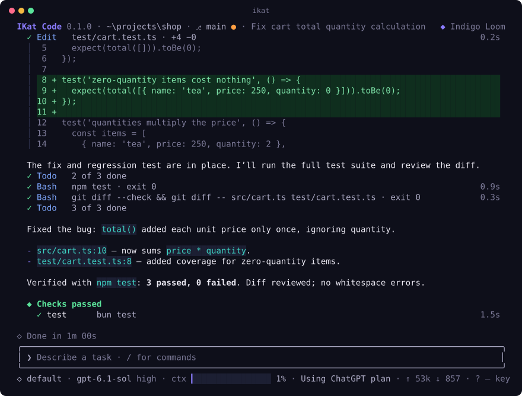
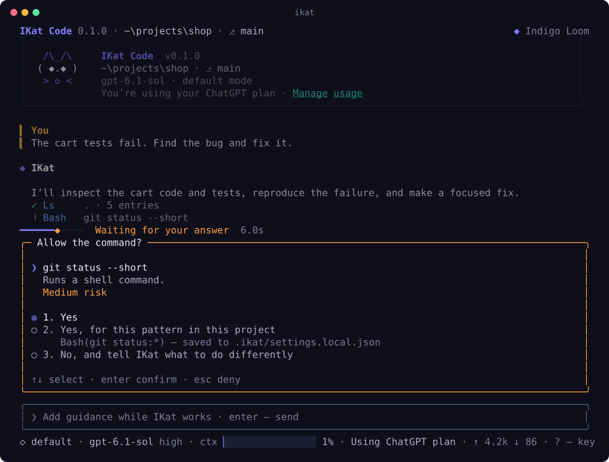

<p align="center">
  <b>English</b> · <a href="README.ru.md">Русский</a>
</p>

# IKat Code

IKat is an AI coding agent that works in your terminal. You describe a task in plain words,
and it reads your project, changes the code, runs your tests and tells you what it did.
It works with the ChatGPT plan you already pay for, so there is nothing else to buy.



*A real session: the cart tests failed, IKat found that quantities were ignored, fixed one line,
added a test and ran the suite.*

> [!NOTE]
> The first public release is being prepared. Until it is published, the install commands below
> have nothing to download yet. Watch this repository (Releases only) to hear when it is out.

## Install

**macOS and Linux**

```sh
curl -fsSL https://github.com/IKatCode/ikat-code/releases/latest/download/install.sh | sh
```

**Windows** (in PowerShell)

```powershell
irm https://github.com/IKatCode/ikat-code/releases/latest/download/install.ps1 | iex
```

On Windows, IKat runs commands in Git Bash, so you need [Git for Windows](https://git-scm.com/download/win).
The installer also uses `ssh-keygen` to check the release signature; current Windows 10 and 11
have it already (the "OpenSSH Client" feature).

The installer downloads the build for your system, checks it against the signed checksums of the
release and puts `ikat` into `~/.ikat/bin` (on Windows `%LOCALAPPDATA%\ikat\bin`), then adds that
folder to your PATH. Open a new terminal afterwards so the PATH change takes effect.

Builds exist for macOS (Intel and Apple Silicon), Linux (x64 and arm64, glibc and musl) and
Windows (x64 and arm64).

## First run

```sh
cd path/to/your/project
ikat
```

The first time, IKat asks how to reach a model. Pick **ChatGPT plan** and sign in in the browser
window that opens. That's the whole setup. Plus and Pro plans work.

Then type what you need, the way you would ask a colleague:

```
The checkout total ignores discounts on bundles. Find out why and fix it.
```

IKat looks around the code, makes a short plan, edits files and runs your checks. When it is done,
it tells you what it changed and how it made sure the change works.

Other ways to connect a model, if you prefer:

- an API key: `ikat login openai` (also `anthropic`, `google`, `openrouter`). The key goes to
  your system's keychain, not to a plain file;
- a model on your own machine: start Ollama, LM Studio, llama.cpp or vLLM and IKat finds it;
- any OpenAI-compatible endpoint, from the same first-run screen.

## Working with it

**It asks before it does anything risky.** Before running a command or changing a file, IKat
shows what it wants to do and how risky it is. You can allow it once, allow that kind of command
for this project from now on, or say no and tell it what to do instead.



If you trust it with more, switch modes with `Shift+Tab`: `accept-edits` lets it change files
without asking, `plan` makes it plan first and wait for your go, `readonly` keeps it to reading.

A few things worth knowing:

- `Esc` stops the current step. `Esc` twice (or `/rewind`) rolls files and conversation back to
  an earlier point. Every change IKat makes can be undone.
- `ikat -c` continues the last conversation in this folder, `ikat -r` lets you pick an older one.
- `/init` writes an `IKAT.md` file with notes about your project: how to build it, how to test it,
  what to keep in mind. IKat reads it at the start of every session, and you can edit it.
- Type `/` to see all commands and `?` to see all keys.

**For scripts and CI** there is a mode without the interface:

```sh
ikat -p "Fix the failing test in cart.test.ts"
```

Add `--output-format json` or `stream-json` to read the result from another program.

## Safety

On macOS and Linux, commands that IKat runs go through a sandbox: they can write only inside your
project and a scratch folder, and have no network unless your settings open it for certain hosts.
Things like `npm install` ask you first and then run outside the sandbox.

Windows has no such sandbox yet. There, IKat asks you about every shell command unless you have
allowed it. If you want the sandbox on Windows, run IKat inside WSL.

A project can bring its own instructions and settings, for example commands it allows without
asking. IKat shows you what they are and applies them only after you say you trust the folder.

## Privacy

Your code and your requests go to the model provider you choose. IKat has no telemetry: it does
not collect or send anything about how you use it.

## Updating and removing

To update, run the install command again. It replaces the old version with the latest one.

To remove IKat, delete the `bin` folder the installer created (`~/.ikat/bin`, or
`%LOCALAPPDATA%\ikat\bin` on Windows) and remove it from your PATH. Your sessions and settings
live in `~/.ikat`; delete that folder too if you want nothing left behind.

## When something goes wrong

Run `ikat doctor`. It checks your terminal, Git, the model connection and the settings, and says
in plain words what to fix. If that doesn't help, [open an issue](https://github.com/IKatCode/ikat-code/issues)
and paste what `ikat doctor` printed.

The interface speaks English and Russian and picks the language of your system.

## License

IKat is free to use, at home and at work, including for commercial projects. It is not open
source: please don't share copies (send people to this page instead), modify it or take it apart.
The code IKat writes in your projects belongs to you. The full text is in [LICENSE](LICENSE).
